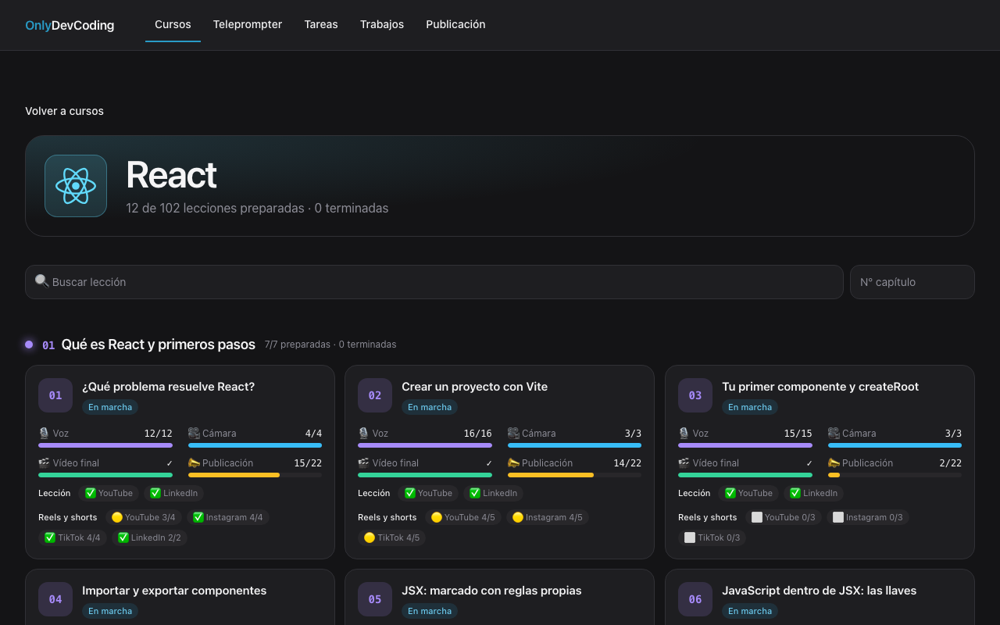
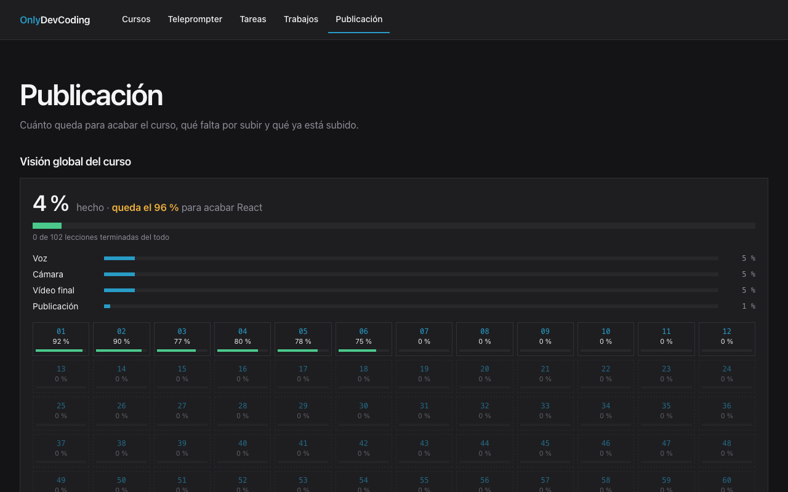
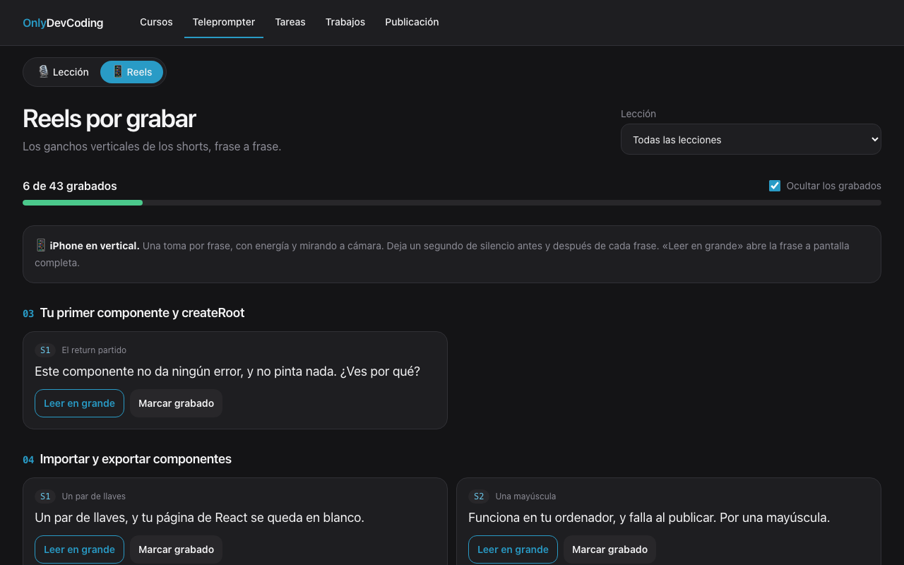
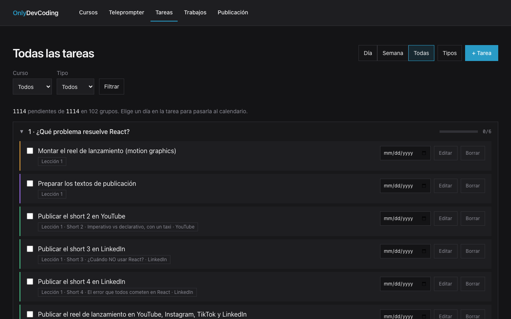
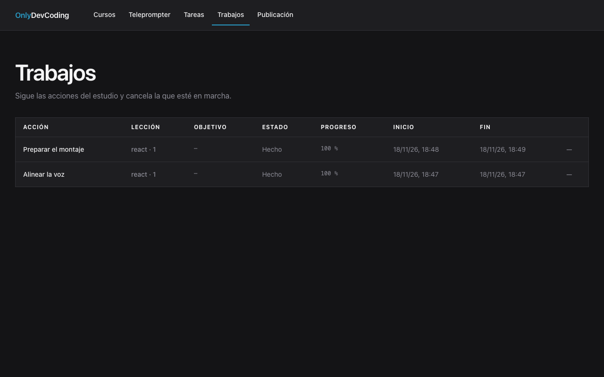
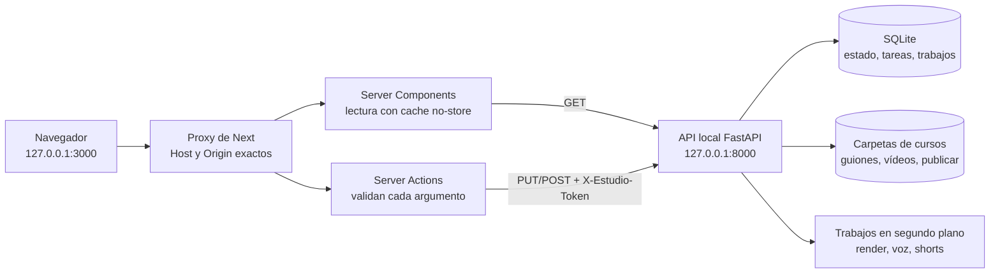
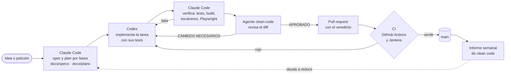
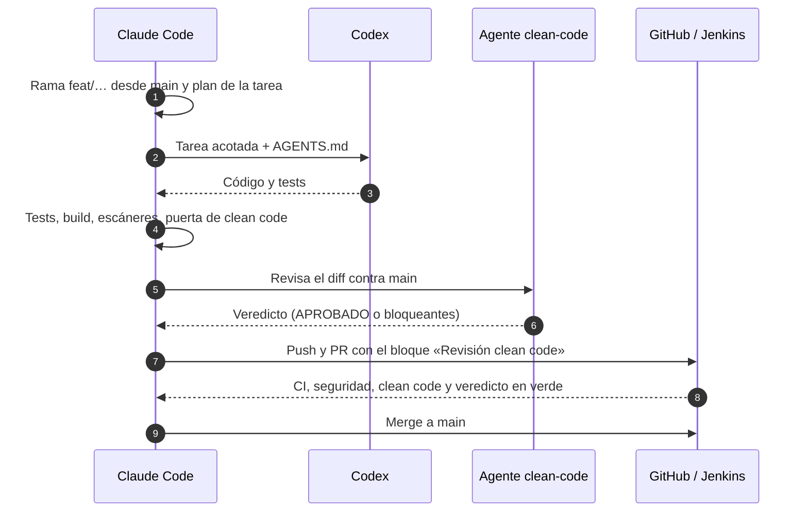
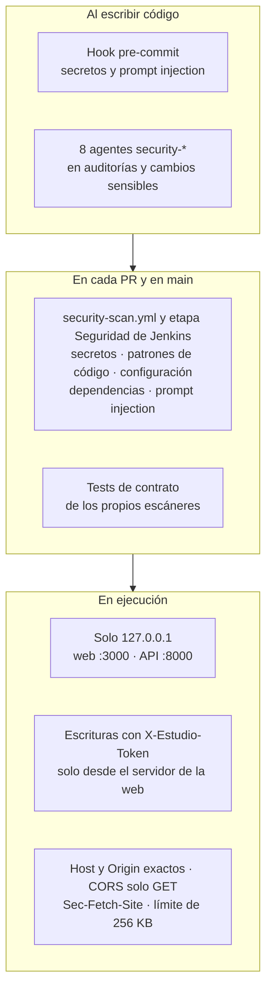
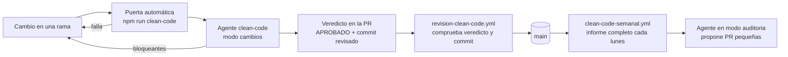

# OnlyDevCoding Estudio Web

Interfaz local del estudio de OnlyDevCoding: los cursos, las lecciones y su estado de
producción (guion, voz, cámara, montaje y publicación), el teleprompter para grabar, la
publicación en YouTube, Instagram, TikTok y LinkedIn, y un planificador de tareas. Está
construida con Next.js 16, React 19, TypeScript y Tailwind CSS 4, y consume la API local del
estudio ([onlydevcoding-estudio-api](https://github.com/pedroleni/onlydevcoding-estudio-api)).

La aplicación no tiene autenticación ni despliegue público: solo escucha en `127.0.0.1`.

## Capturas

| | |
|---|---|
|  |  |
| **Curso**: lecciones por módulo con su avance de voz, cámara, vídeo y publicación. | **Publicación**: cuánto queda para acabar el curso y qué falta por subir en cada red. |
|  |  |
| **Teleprompter de reels**: los ganchos verticales por grabar, en pequeño o a pantalla completa. | **Tareas**: la lista total de tareas por lección; cada una se pasa al calendario eligiendo un día. |



**Trabajos**: las acciones largas (alinear la voz, montar, renderizar, preparar shorts…) con
su estado, su progreso y la opción de cancelarlas.

## Arquitectura de la aplicación



- Las páginas son Server Components que leen la API en cada petición.
- Las escrituras van por Server Actions (`src/lib/acciones*.ts`): validan los argumentos,
  añaden el token de escritura en el servidor y refrescan la vista.
- El token nunca llega al navegador: no hay ninguna variable `NEXT_PUBLIC_*` sensible.

## Cómo se desarrolla

El código lo escriben agentes de IA, pero nada llega a `main` sin pasar por las mismas
puertas: tests, seguridad, clean code y CI. Cada herramienta tiene un papel fijo.

| Quién | Qué hace | Qué no hace |
|---|---|---|
| **Claude Code** | Diseña (spec y plan por fases en `docs/`), reparte el trabajo, verifica por su cuenta (tests, build, escáneres, Playwright a varios anchos), pasa el agente de clean code, hace los commits, abre las PR y las integra cuando la CI está en verde. | No da por buena la palabra de otro agente: todo se vuelve a comprobar. |
| **Codex** | Implementa una tarea acotada del plan con sus tests, siguiendo `AGENTS.md`. | No toca `.git` ni la red (su sandbox no lo permite) ni comprueba la interfaz en el navegador: eso lo hace Claude Code. Si se queda sin cuota, implementa Claude Code. |
| **Agente `clean-code`** | Revisa el diff de cada PR contra `docs/clean-code.md` y emite un veredicto; en modo `auditoria` revisa el repo entero. | No edita: informa. Se ejecuta con la suscripción de Claude Code, sin claves de API. |
| **Agentes `security-*`** | Ocho checklists de seguridad (`.claude/agents/security-*.md`) para auditorías y cambios sensibles. | Solo reportan hallazgos con más del 80 % de confianza. |
| **GitHub Actions y Jenkins** | Repiten todas las comprobaciones en limpio en cada PR y en `main`. | No integran nada por su cuenta. |



### Un cambio, paso a paso



## Seguridad

La aplicación es local y sin autenticación, así que la seguridad se basa en no exponerse y
en comprobar cada cambio antes de que llegue a `main`.



- **Hook `pre-commit`** (`bash scripts/security/install_hooks.sh`): bloquea secretos y
  texto de prompt injection antes de que entren en un commit.
- **Escáneres** en `scripts/security/`: secretos, patrones de código peligrosos,
  configuración (workflows con permisos mínimos y acciones fijadas por SHA), dependencias y
  prompt injection. Se ejecutan en local, en GitHub (`security-scan.yml`) y en Jenkins.
- **Agentes de seguridad**: ocho dominios en `.claude/agents/security-*.md`, con los
  precedentes del proyecto en `security/security-review-instructions.md`. Las auditorías
  completas se guardan en `security/reviews/`.
- **Repositorio público**: nada de rutas absolutas, emails ni datos reales; los valores
  privados solo viven en `.env`, que está ignorado.

## Clean code

Las normas están en [`docs/clean-code.md`](docs/clean-code.md): las convenciones del repo,
las normas de cada tecnología con sus fuentes, los umbrales y la checklist del revisor.



1. **Puerta automática** (bloquea la PR): ESLint con complejidad ciclomática y cognitiva, tamaño, anidación, parámetros y reglas de legibilidad; `jscpd` para código duplicado; `knip` para archivos, exportaciones y dependencias sin uso. Se ejecuta con `npm run clean-code`.
2. **Revisión del agente** (bloquea la PR): el agente `clean-code` revisa el diff contra
   `main` y su bloque «Revisión clean code» va en la descripción. La CI comprueba que dice
   `Veredicto: APROBADO` y que es del último commit: si llegan más commits, se vuelve a pasar.
3. **Revisión completa periódica**: cada lunes `clean-code-semanal.yml` genera el informe
   completo (resumen de la ejecución y artefacto `informe-clean-code`); cuando se pide, el
   agente hace la auditoría del repo entero y propone PR pequeñas para reducir deuda.
4. **Deuda congelada**: lo que ya incumplía antes de las normas está en `eslint-suppressions.json` y solo puede bajar (`npm run clean-code:podar`); el código nuevo no puede añadir excepciones.

## Integración continua

| Comprobación | GitHub Actions | Jenkins (`Jenkinsfile`) |
|---|---|---|
| Escáneres de seguridad y sus tests | `security-scan.yml` | etapa *Seguridad* |
| Lint, tests y build | `ci.yml` · job `verify` | etapas *Lint*, *Tests* y *Build* |
| Puerta de clean code | `ci.yml` · job `clean-code` | etapa *Clean code* |
| Veredicto del agente en la PR | `revision-clean-code.yml` | — (Jenkins construye `main`) |
| Informe completo de clean code | `clean-code-semanal.yml` (lunes) | — |

Jenkins corre en local (Docker, `127.0.0.1:8090`) y replica la CI de GitHub con las mismas
versiones y los mismos comandos.

## Puesta en marcha

### Preparación

Instala las dependencias fijadas en el lockfile:

```bash
npm ci
```

Crea el archivo de configuración local a partir del ejemplo:

```bash
cp .env.example .env
```

Los valores de ejemplo apuntan a `http://127.0.0.1:8000`. No añadas secretos,
rutas privadas ni datos reales del estudio a los archivos versionados.

Genera un token para las escrituras locales y copia exactamente el mismo valor
en `ESTUDIO_TOKEN` del `.env` de la API y de la web:

```bash
python3 -c "import secrets; print(secrets.token_urlsafe(32))"
```

El token solo se lee en el servidor. No lo pongas en una variable
`NEXT_PUBLIC_*` ni lo incluyas en archivos versionados.

### Uso diario

Antes de abrir la web, arranca la API local del estudio en
`127.0.0.1:8000`. Para consultar el estudio, crea una build de producción y
arráncala con:

```bash
npm run estudio
```

La web estará disponible únicamente en
[http://127.0.0.1:3000](http://127.0.0.1:3000). Los scripts `dev`, `start` y
`estudio` escuchan solo en `127.0.0.1`, no en las interfaces de la red local.
Usa esa dirección en vez de `localhost`: así la web y la API
(`127.0.0.1:8000`) pertenecen al mismo sitio, y la API solo sirve los medios
a peticiones que no lleguen marcadas como `Sec-Fetch-Site: cross-site`. Las peticiones con
`Host: localhost:3000` se redirigen a la dirección canónica; cualquier otro
`Host` se rechaza con un 400 en las rutas de la aplicación para reducir la
exposición a DNS rebinding.

### Desarrollo

Usa `npm run dev` únicamente mientras programas. Las rutas internas
`/__nextjs_*` y `/_next/*` de `next dev` no pasan por `src/proxy.ts`, incluida
`/__nextjs_launch-editor`; por eso el modo de desarrollo no ofrece la misma
protección de `Host` que el uso diario con `npm run estudio`. En la build de
producción los endpoints `__nextjs` de desarrollo no existen.

Si la API no está en marcha, las pantallas muestran un aviso en lugar de
quedarse en blanco. Las escrituras de publicación se realizan mediante Server
Actions que validan sus argumentos. El salto del navegador a la Server Action
está protegido por el Proxy, que exige el `Host` exacto `127.0.0.1:3000` y, en
todo método distinto de GET y HEAD, el `Origin` exacto
`http://127.0.0.1:3000`; Next comprueba además que `Origin` coincida con
`Host`. No se debe relajar esa protección del Proxy. Desde el servidor, la web
envía `X-Estudio-Token` a la API local: ese token protege la llamada de la web
a la API, no el salto del navegador a la Server Action.

### Comprobaciones

```bash
npm run lint
npm test -- --run
npm run build
npm run clean-code
for s in scripts/security/scan_*.sh; do bash "$s"; done
```
